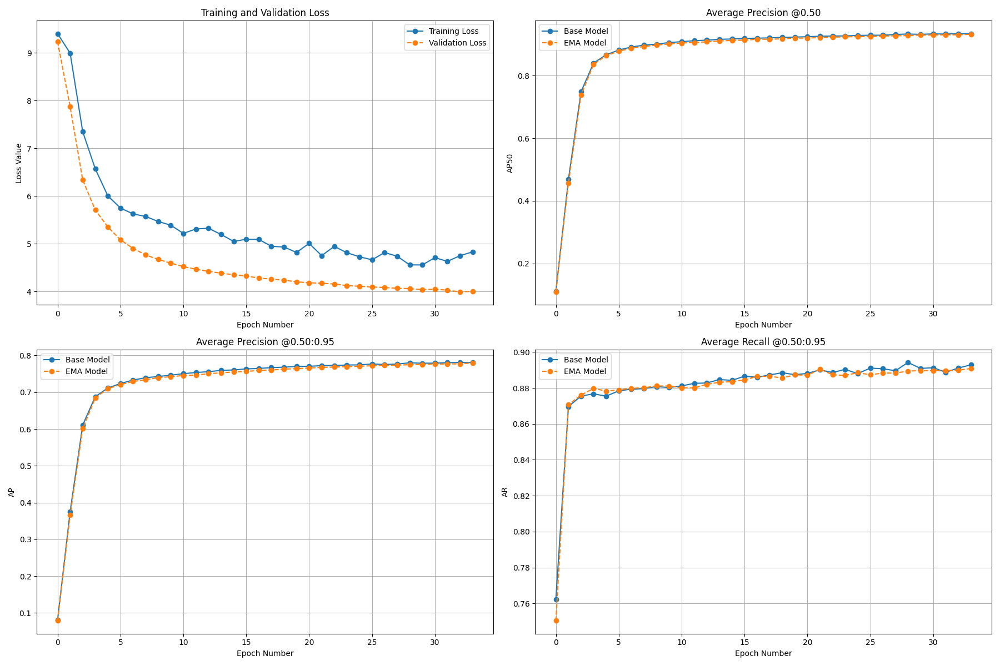

<div align="center">

# 👟 AI Shoe Detector — RF-DETR Object Detection

A Python + Jupyter portfolio application for training and running local inference with RF-DETR Medium to detect `Slipper` and `Sneaker` objects from COCO-format image datasets.


</div>

---

## 📌 Project Overview

**AI Shoe Detector** is a computer-vision application designed to train an object-detection model for two visually similar shoe classes: `Slipper` and `Sneaker`.

The project uses an **RF-DETR Medium model** with **PyTorch**. A Jupyter training workflow validates COCO dataset splits, selects the available CPU/CUDA device, configures fine-tuning, and stores training outputs. Supporting Python utilities extract frames from local videos and run checkpoint-based inference on local images.

The public repository intentionally excludes the private dataset and trained checkpoint. It does not include a custom frontend, backend, database, authentication system, or HTTP API. Docker Compose is provided only for an optional external RF-DETR model GUI. A small synthetic COCO dataset may be used for local pipeline smoke testing, but its metrics must not be treated as real-world accuracy.

---

## ✨ Features

### 🗂️ Dataset Workspace
- 🧾 **COCO-format dataset validation** requiring a `train` split and supporting optional `valid` and `test` splits
- 🏷️ **English detection classes** using `Slipper` and `Sneaker`
- 📊 **Dataset reporting** for image counts, annotation counts, category counts, and crowd annotations
- 🎞️ **Periodic video-frame extraction** with configurable sampling interval and JPEG quality
- 🔒 **Private-data separation** keeping source videos, images, annotations, and checkpoints outside the public repository

### 🧠 AI Object Detection
- 🤖 **RF-DETR Medium** model initialization through the public `rfdetr` API
- 🎯 **COCO object-detection fine-tuning workflow** using PyTorch
- 🖥️ **Automatic CPU/CUDA selection** with GPU VRAM-based batch-size support
- ⏱️ **Early stopping**, gradient accumulation, EMA, warmup, and weight decay configuration
- 📈 **COCO evaluation documentation** with recorded historical training metrics

### 🛡️ Reliability and Security Controls
- 📁 **Local path validation** for datasets, checkpoints, images, and video directories
- 📴 **Local-only processing** with no application database, web API, or image-upload service in this repository
- 🧰 **Argument-list FFmpeg execution** without shell command evaluation for audio removal
- 🐳 **Localhost-only optional Compose bindings** for the external GUI
- 🔐 **Explicit external image references** instead of mutable default container tags
- 📦 **Pinned direct Python dependencies** and repository contract tests

### 🖥️ Developer Tools
- 📓 **Jupyter training notebook** for dataset preparation and RF-DETR training
- 🔎 **Checkpoint inference CLI** for local image prediction
- 🎬 **OpenCV frame extraction CLI** for local video preparation
- 🔇 **FFmpeg audio-removal utility** for local `.mov` files
- 👨‍💻 **Developer attribution for Muhammad Ali Nawaz 2026**

---

## 🖼️ Screenshots

| AI Shoe Detector | 
| --- |
|  |

---

## 📊 Recorded Training Results

The following values are recorded from the original private training run. They are not independently reproducible from this public archive because the dataset and checkpoint are not included.

| Metric | Recorded result |
| --- | ---: |
| Test mAP@0.50:0.95 | 76.63% |
| Test mAP@0.50 | 93.37% |
| Test precision | 90.59% |
| Test recall | 88.00% |
| Slipper mAP@0.50:0.95 | 78.75% |
| Sneaker mAP@0.50:0.95 | 74.52% |
| Training time | 1 h 58 min |

---

## 🧰 Tech Stack

### Training and Inference
- Python 3.11+
- PyTorch
- RF-DETR Medium
- OpenCV
- NumPy and SciPy

### Dataset and Experiment Workflow
- COCO 1.0 annotations
- CVAT-compatible dataset exports
- Jupyter Notebook
- CUDA-compatible training environments

### Quality Assurance
- Python `unittest`
- Python compilation checks
- JSON and notebook validation
- GitHub Actions CI
- Dependency version pinning

### Optional Local GUI
- Docker Compose
- Externally maintained RF-DETR model GUI images

---

## 📁 Folder Structure

```text
ai-shoe-detector/
├── .github/workflows/ci.yml
├── docs/
│   └── metrics_plot.png
├── notebooks/
│   └── train-rfdetr.ipynb
├── scripts/
│   ├── extract_frames.py
│   ├── infer.py
│   └── remove_audio.py
├── tests/
│   └── test_repository_contract.py
├── .env.example
├── .gitignore
├── config.sample.json
├── docker-compose.yml
├── LICENSE
├── README.md
└── requirements.txt
```

---

## 🔐 Environment Variables

This repository does not require API keys or application secrets. Never commit a real `.env` file.

The optional Docker Compose GUI requires reviewed external image references. Copy `.env.example` to `.env` and use immutable image references with digests:

```env
RFDETR_BACKEND_IMAGE=registry.example/rfdetr-backend:release@sha256:<digest>
RFDETR_FRONTEND_IMAGE=registry.example/rfdetr-frontend:release@sha256:<digest>
```

The supplied `.env.example` intentionally leaves these values empty. Do not start the optional GUI until the image references have been reviewed.

---

## 🚀 Getting Started on Windows

### Prerequisites
- Windows 10 or 11
- Python 3.11 or newer
- A CUDA-capable GPU is recommended for training
- Jupyter Notebook
- **FFmpeg** installed and added to system PATH if using `scripts/remove_audio.py`

---

## ▶️ Run the Complete Project

Use **Windows PowerShell** or CMD from the project root.

### 1. Create a Clean Virtual Environment
```powershell
py -m venv .venv
.\.venv\Scripts\Activate.ps1
py -m pip install --upgrade pip
```

### 2. Install Training and Inference Dependencies
```powershell
py -m pip install -r requirements.txt
```

The pinned RF-DETR requirement includes its `train` and `loggers` extras, so a clean environment contains the PyTorch Lightning components required by `model.train()`.

### 3. Prepare the Private Dataset

Create the following local structure. The dataset is intentionally not included in this repository:

```text
shoe-dataset/
├── train/
│   ├── _annotations.coco.json
│   └── *.jpg
├── valid/
│   ├── _annotations.coco.json
│   └── *.jpg
└── test/
    ├── _annotations.coco.json
    └── *.jpg
```

The annotation categories must be named `Slipper` and `Sneaker`.

For a pipeline smoke test, use a local COCO dataset with the same structure and labels. The verified synthetic smoke-test run used 12 images per split, 36 images total, and one object per image. Synthetic images validate dataset loading, fine-tuning, checkpoint creation, and inference only; they do not demonstrate production accuracy.

### 4. Start the Training Notebook
```powershell
py -m jupyter notebook notebooks/train-rfdetr.ipynb
```

Set `dataset_path` to the location of the private COCO dataset, then run the notebook cells. Training produces checkpoints and metrics under `trained_model/`.

For the CPU smoke-test configuration, use:

```python
dataset_path = r"D:\path\to\synthetic-shoe-dataset"
output_path = r"D:\path\to\synthetic_trained_model"
batch_size = 1
device_setting = "cpu"
grad_accum = 1
epochs = 20
quick_test = False
```

The verified synthetic run completed 20 epochs and produced `checkpoint_best_total.pth`. Its validation mAP reached `1.0000` on the synthetic validation split; this result is intentionally not presented as real-image model performance.

### 5. Run Local Checkpoint Inference
```powershell
py scripts/infer.py `
  --checkpoint trained_model/checkpoint_best_total.pth `
  --image path\to\image.jpg
```

### 6. Optional Video Frame Extraction
```powershell
py scripts/extract_frames.py `
  --input-dir source_videos `
  --output-dir extracted_frames `
  --every-n-frames 30
```

---

## 🧪 Test the Project

The automated checks do not require the private dataset, trained checkpoint, or a live external GUI.

### Complete Repository Quality Check
```powershell
.\.venv\Scripts\Activate.ps1
py -m unittest discover -s tests -v
py -m compileall -q scripts
```

### Validate JSON and Notebook Code
```powershell
py -c "import json; json.load(open('config.sample.json', encoding='utf-8')); json.load(open('notebooks/train-rfdetr.ipynb', encoding='utf-8')); print('Project JSON files are valid')"
```

### Verify Installed Dependencies
```powershell
py -m pip check
py -c "import torch, torchvision, rfdetr, pytorch_lightning, cv2, numpy, scipy; print('Project dependencies imported successfully')"
```

---

## 📜 Available Commands

| Command | Description |
| --- | --- |
| `py -m jupyter notebook notebooks/train-rfdetr.ipynb` | Open the RF-DETR training notebook |
| `py scripts/extract_frames.py --input-dir source_videos --output-dir extracted_frames` | Extract periodic JPEG frames from local videos |
| `py scripts/infer.py --checkpoint model.pth --image image.jpg` | Run RF-DETR checkpoint inference on one local image |
| `py scripts/remove_audio.py` | Remove audio from local `.mov` files with FFmpeg |
| `py -m unittest discover -s tests -v` | Run repository contract tests |
| `py -m compileall -q scripts` | Compile Python utility scripts |

---

## 🔌 Main API Endpoints

This repository does not include a custom HTTP API. It is a local notebook and command-line computer-vision project.

The optional Docker Compose configuration connects externally maintained RF-DETR model-GUI containers. Their internal API and frontend implementation are outside this repository and are not claimed as project-owned code.

---

## 🎯 Project Flow

```text
User provides local videos or a COCO dataset
└── Local preparation and validation tools
    ├── Extract periodic frames with OpenCV
    ├── Annotate images in a COCO-compatible workflow
    ├── Validate train, valid, and test annotation files
    └── Start RF-DETR Medium fine-tuning in Jupyter
        ├── Select CPU or CUDA automatically
        ├── Apply configured training controls
        ├── Evaluate with COCO metrics
        └── Save checkpoints and training outputs
            └── Run local checkpoint inference on an image
```

---

## 🤖 AI Processing Flow

```text
COCO Dataset and RF-DETR Medium
└── Training Notebook
    ├── Validate dataset split structure
    ├── Initialize RF-DETR Medium
    ├── Fine-tune with PyTorch
    ├── Apply early stopping, EMA, and gradient accumulation
    └── Save model checkpoint and metrics
        └── Local image inference
            ├── Validate checkpoint path
            ├── Validate image path
            └── Print RF-DETR prediction results
```

---

## 🧑‍💻 Author

**Muhammad Ali Nawaz**  
Python Developer / AI Developer

---

## 📄 License

This project is licensed under the [MIT License](LICENSE).

---

<p align="center">
  <b>⭐ If this project helps you, consider starring the repository!</b>
</p>
